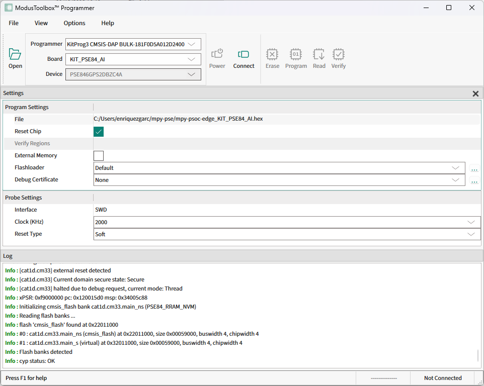

.. _pse_mpy_install:

Installing MicroPython 
======================

To facilitate the installation of the MicroPython PSOC™ Edge port, the ``mp-ifx-flash.py`` Python script is provided. It is compatible with Windows,
Linux and MacOS.

Before downloading and running the script, it is recommended to create a new folder to keep all the related files together.
For example:

.. code-block:: bash
    
    $ mkdir mp-install
    $ cd mp-install

You can easily download the script from the terminal using the following command:

.. code-block:: bash
    
    $ curl -s -L https://raw.githubusercontent.com/infineon/micropython-psoc-edge/psoc-edge-main/ports/psoc-edge/tools/mp-ifx-flash.py > mp-ifx-flash.py

Ensure you have a recent version of `Python3.x <https://www.python.org/downloads/>`_  installed and the `pip <https://pip.pypa.io/en/stable/installation/>`_ package installer.
Then install the following packages:

.. code-block:: bash                

    $ pip install requests

Find all available commands and options by running the script with the following command:

.. code-block:: bash
    
    $ python mp-ifx-flash.py --help

.. _pse_device_setup:

Device setup
-------------

In order to setup MicroPython in a PSOC™ Edge board, run the ``mp-ifx-flash.py`` script without any command.
It starts the interactive mode: follow the instructions to select the target PSOC™ Edge board, the firmware source
and, optionally, the serial number of the board debugger:

.. code-block:: bash
    
    $ python mp-ifx-flash.py

The interactive mode needs a terminal and takes care of the following steps:

* Install openocd, which is the software required to deploy a firmware file on PSOC™ Edge controllers (an Infineon openocd version 5.8 or newer already available in the ``PATH`` is used instead)
* Download the selected firmware
* Deploy the firmware on your board

The firmware source can be a release from the Infineon fork, an official MicroPython release or preview build from the
`MicroPython download page <https://micropython.org/download/KIT_PSE84_AI/>`_, or local files. The commands described in the
following sections skip the questions, so they can be used in scripts.

Flash a firmware package
^^^^^^^^^^^^^^^^^^^^^^^^

A firmware package is a *.zip* file containing the *.hex*, *.cfg* and *.FLM* files. Use the ``from-package`` command to flash
a package you already have, for example one downloaded from the MicroPython download page:

.. code-block:: bash
    
    $ python mp-ifx-flash.py from-package -b KIT_PSE84_AI -z pathtodir/firmware.zip

Download a fork release
^^^^^^^^^^^^^^^^^^^^^^^^^^^^

The ``from-remote`` command downloads a release from the Infineon fork and flashes it. The latest release is used by default. You can check the list of available releases in the `GitHub release section <https://github.com/infineon/micropython-psoc-edge/releases>`_. 

To flash the latest release, pass the board. To flash a specific version, also pass it with the ``-v`` flag:

.. code-block:: bash
    
    $ python mp-ifx-flash.py from-remote -b KIT_PSE84_AI
    $ python mp-ifx-flash.py from-remote -b KIT_PSE84_AI -v v0.1.0

.. note::
    
    The version must be a tag that exists in the release section, in the format *vx.y.z*.
    The script reports an error if the release is not found.

Flash individual files
^^^^^^^^^^^^^^^^^^^^^^^^^

The ``from-files`` command flashes a *.hex* file together with the *.cfg* and *.FLM* files that openocd needs. These two files are part of the
firmware package, and are also available in the *ports/psoc-edge/boards/KIT_PSE84_AI/bsp-cfg* folder of the repository.
This is also the way to flash any other *.hex* file, like the CM55 application. Specify the board and the paths of the three files:

.. code-block:: bash
    
    $ python mp-ifx-flash.py from-files -b KIT_PSE84_AI -f pathtodir/firmware.hex -c pathtodir/qspi_config.cfg -l pathtodir/PSE84_SMIF.FLM

Multiple devices deployment
^^^^^^^^^^^^^^^^^^^^^^^^^^^^

If you have multiple PSOC™ Edge boards connected to your computer, you can distinguish them by their serial number, and flash them one by one.
To do so, use the ``-n`` flag to provide the serial number of the target board as shown below (all the commands support it):

.. code-block:: bash
    
    $ python mp-ifx-flash.py from-remote -b KIT_PSE84_AI -n 181F0D5A01212300

Alternatively, you can deploy a firmware file to all connected boards if you have a device YAML file following the `etdevs <https://pypi.org/project/etdevs/>`_ specification.

.. note::

    This option is only supported on **Linux** and **MacOS** systems. etdevs is not currently enabled for Windows.

First, ensure that the etdevs package is installed:

.. code-block:: bash
    
    $ pip install etdevs

Then, create a YAML file (e.g., *devs.yaml*) with the board ``name`` and the ``uid`` (debugger serial number) for all the connected available boards:

.. code-block:: yaml

  - name: KIT_PSE84_AI
    uid: 181F0D5A01212300

  - name: KIT_PSE84_AI
    uid: 181F0D5A01212400
  
    ...
      

Finally, run any of the commands providing the YAML file with the ``-d`` flag. The firmware is deployed to all the boards of the file that match
the selected board name (or only to the one selected with ``-n``):

.. code-block:: bash
    
    $ python mp-ifx-flash.py from-package -b KIT_PSE84_AI -z pathtodir/firmware.zip -d devs.yml

Getting the firmware
^^^^^^^^^^^^^^^^^^^^

The firmware of the Infineon fork (a *.hex* file for each board and, in newer releases, also the *.zip* package) is available in the `GitHub release section <https://github.com/infineon/micropython-psoc-edge/releases>`_.
The official MicroPython firmware packages (*.zip*) are available in the `MicroPython download page <https://micropython.org/download/KIT_PSE84_AI/>`_. 
All PSOC™ Edge firmware versions of the fork for each of the supported boards can be found in the release section. 

    .. image:: img/gh-releases.png
        :alt: GitHub MicroPython PSOC Edge Releases
        :width: 520px

Other installation methods
--------------------------

Cypress Programmer
^^^^^^^^^^^^^^^^^^

Alternatively, you can directly flash the firmware binary file with the `ModusToolbox™ Programming Tools
<https://softwaretools.infineon.com/tools/com.ifx.tb.tool.modustoolboxprogtools>`_ (minimum version required is 1.6.0).

It allows you to program the PSOC™ Edge microcontroller family with just a few clicks from your Windows, Linux, or MacOS machine.
Follow the instructions at the provided link to download and install the tool.

After that, select the downloaded MicroPython firmware *.hex* file to be deployed on the PSOC™ Edge. Then, in
the upper menu, select the connected *Board*, click on *Connect*, and finally click on *Program*.
The log section will show the progress and notify you when the firmware deployment on the controller is completed.

For a detailed description on how to use the ModusToolbox™ Programmer tool, please consult the `ModusToolbox™ Programmer User Guide
<https://www.infineon.com/assets/row/public/documents/30/44/infineon-modustoolbox-gui-user-guide-usermanual-en.pdf?fileId=8ac78c8c7fb5929e017ff76ada40103c>`_.

